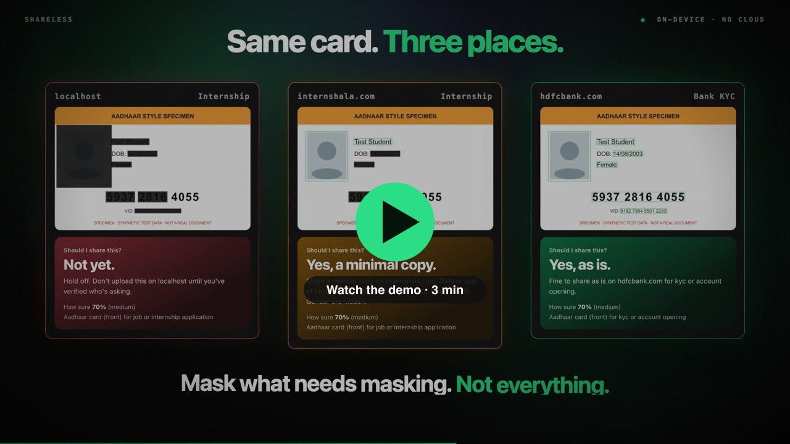
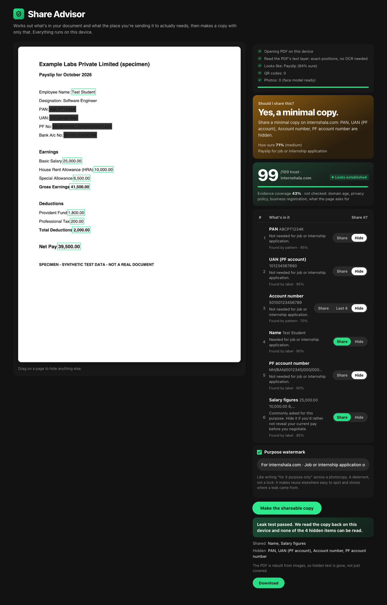
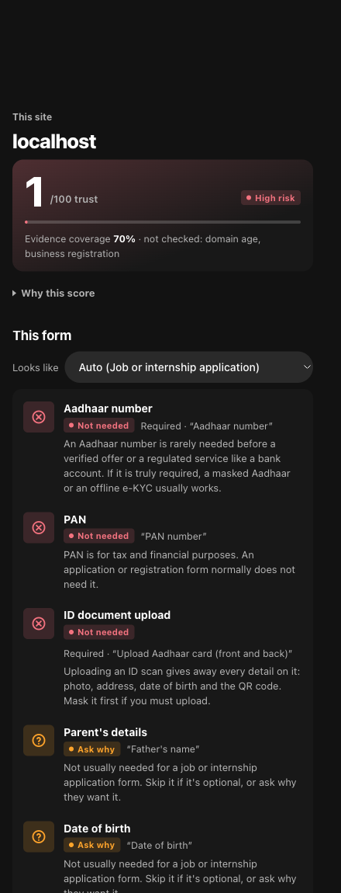
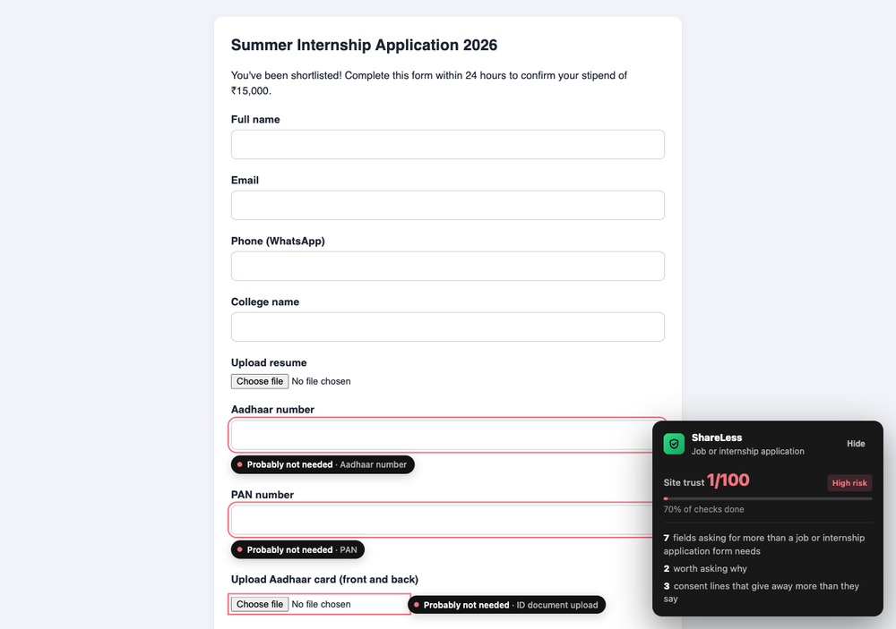
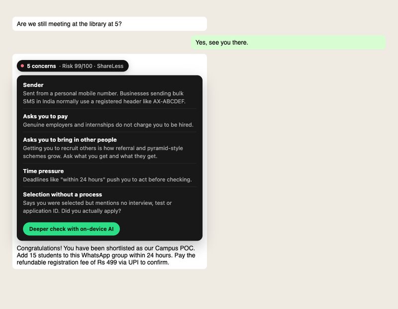

# ShareLess

**Who's asking, what they want, and the least you can give.**

ShareLess is a Chrome extension for India that sits between you and every form, upload and message. Before you hand over an Aadhaar, a PAN or a payslip, it works out what the place you're sending it to actually needs for that purpose, and makes a copy with only that. It reads the privacy policy you'll never read, flags the fields that over-ask, and tells you how much to trust the site and why.

Everything runs on your device. No account, no server, and your documents never leave Chrome.

[](docs/media/ShareLess_Demo.mp4)

<p>
  
  
</p>

## Why

- Indians lost about ₹22,500 crore to cyber fraud in 2025 (MHA). Loans opened on someone else's PAN or Aadhaar usually trace back to a photocopy handed to a hotel, PG, courier, recruiter or SIM shop.
- Job seekers are the softest target. 93% have seen fake offers. Recruiters ask for PAN, Aadhaar and payslips before there's any offer, and people redact payslips by hand in PDF editors because nothing does it for them.
- Only 16% of people know about the DPDP Act, and 69% don't know they can withdraw consent (PwC, 2024).

The research behind these choices, including what we got wrong and changed, is in [`docs/research-2026-11.md`](docs/research-2026-11.md).

## What it does

### Before you share

**Share Advisor.** Pick any file for an upload field and ShareLess offers to check it first. It reads the document on-device and works out:
- what kind of document it is: Aadhaar, PAN, passport, payslip, offer letter, marksheet, bank statement or resume
- the fields it contains, such as the number, DOB, photo, QR code, UAN, PF number or salary

Then it decides, for each field, whether *this* purpose on *this* site needs it.

| Same Aadhaar card | Result |
|---|---|
| Internship form on an established site | Minimal copy: Aadhaar reduced to the last 4 digits; DOB, gender, VID and QR hidden; name and photo kept |
| KYC on an established bank (`hdfcbank.com`) | Shared as is, no boxes |
| Event registration (back of the card) | Address, parent's name and QR hidden |
| A form on a high-risk site | "Not yet." Don't upload until you've verified who's asking |

Each field shows a reason, the detector that found it, and a confidence. You can override any of them. You can also:
- add a **purpose watermark** ("For example.com · Job application only · date"), a deterrent that shows where a leak came from
- rely on the copy masking a detail **at every place it appears**

Before you download, a **leak test** reads the copy back with OCR and the QR detector, and fails if any hidden value, or part of one, is still readable. PDFs are rebuilt from images, so hidden text is gone rather than just covered.

The Advisor also covers two common snags:
- **If they won't take a masked Aadhaar:** it points to Aadhaar app or QR offline verification and VIDs, and gives you a polite note asking which rule requires the full number.
- **After an offer:** a "Joining or background verification" purpose expects ID and bank details, with the reminder that this applies only to a company you've checked.



**Form check.** On any page with a form:
- **Over-asks:** fields asking for more than the form's purpose needs are marked "Probably not needed" or "Ask why", with the reason on hover.
- **Type guard:** typing an Aadhaar or PAN number into one of those fields warns you on the spot.
- **Joining forms that don't say so:** a form with no stated purpose that asks for account number, IFSC, a cancelled cheque and PAN gets one question: have you already been selected, through a channel you checked? "Yes" makes bank details and PAN expected (the Aadhaar number is still questioned). "No" keeps them flagged.
- **Privacy policy:** it's found and read automatically. Risky clauses are quoted, for example "partners and affiliates", calls even if you're on DND, "consent is irrevocable". So are consent boxes ticked for you.

**Site trust.** A 1–99 score from named signals, shown with **evidence coverage** (how much was actually checked) and **why this score**. The signals include:
- the bundled top-100k list
- a public phishing feed
- domain age (RDAP)
- lookalike domains, such as `sbi-kyc-update.in`
- vetted Indian domains: `.bank.in`, `.gov.in` and `.ac.in`
- GSTIN and CIN checksums found on the page
- what the page asks for

A form on Google Forms, Blogspot or a site builder doesn't inherit the platform's reputation.

### When someone contacts you



Messages in Gmail, Google Messages for web and WhatsApp Web are checked on screen, and only risky ones get a chip. You can also paste a message or right-click selected text.

The rules catch these patterns:
- fee demands: registration, verification, joining kit, laptop deposit, retake
- requests for an OTP or ID
- "add 15 friends" recruiting
- task scams
- moving the chat to Telegram or WhatsApp
- screen-share and remote-access apps
- APK links
- time pressure
- free-mail senders making job offers

A message is read with its conversation: the subject, the rest of the thread, and whether you've replied. Scheduling, form and meeting links (Calendly, Google Forms, Zoom) aren't concerns, and one rule firing on several links counts once.

**Vouch for a sender.** If you know where a sender came from, say so on the chip: "introduced by my college", "I applied and was interviewed". ShareLess then stops questioning where their messages come from, and a form opened from one of their messages is treated as a joining form. It never clears what a message asks for: fees, OTPs, screen sharing and app installs stay flagged. Vouched senders are listed in the **Privacy** tab and stored only on your device.

Job messages get a **check the company** list: the MCA lookup, the email domain against the company's site, the company's own careers page, and never paying.

### After you share

- **My shares** is a log on your device of what went where, when, and what was hidden.
- **Ask them to delete it** drafts a consent-withdrawal and erasure request to the grievance contact named in their policy. The letter changes with the date:
  - before 13 May 2027, when the DPDP Act's data-principal rights take effect, it's a request under the IT Act's SPDI Rules
  - from that date it cites DPDP sections 6(4), 8(7), 12 and 13
- **Already shared or paid?** gives the official next steps:
  - 1930 and cybercrime.gov.in
  - your bank within 3 working days (RBI zero liability)
  - lock Aadhaar biometrics
  - Sanchar Saathi for SIMs issued on your ID
  - credit report disputes and the RBI Ombudsman
  - EPFO service history
  - Chakshu

## How it decides: the model reads, rules decide, quotes prove

| Tier | What | Used for |
|---|---|---|
| Rules and checksums | Verhoeff (Aadhaar), PAN holder type, GSTIN checksum, CIN, UAN and PF formats, TRAI SMS headers, URL features, policy clause patterns | Always on. Works on every laptop |
| Small vision models | Tesseract OCR, MediaPipe BlazeFace, Chrome's BarcodeDetector, a photo-slot finder, the PDF.js text layer | Reading documents, finding photos and QR codes |
| On-device LLM | Chrome's built-in Gemini Nano (Prompt API), Translator, Language Detector | Message tactics, deeper policy reading, unlabelled names and addresses in letters |

The model never makes the decision:
- Its output must match a JSON schema.
- Every finding must **quote the input**. Quotes are checked against the source, and anything not found is dropped and counted ("1 AI finding was dropped").
- Model findings can add concerns but never clear one a rule found.
- Untrusted text is fenced, and the model is told to ignore instructions inside it.

Gemini Nano needs about 22 GB of free disk and 16 GB of RAM or a GPU, so many laptops won't have it. Everything works on rules alone.

Trust and risk scores come from a log-odds model over named signals (`src/core/trust.js`). The weights are hand-set priors, labelled as uncalibrated in the UI, and displayed scores never read 0 or 100.

## Privacy

Messages, documents, form entries and policy text never leave the device. The only network traffic:
- **Domain names sent to `rdap.org` for age checks.** This only happens when a page asks for sensitive data, the site isn't in the bundled top-100k list, and it isn't a local address.
- **A public phishing list downloaded every 12 hours.** It sends nothing.

Every request is listed in the **Privacy** tab, and **Offline mode** turns all of it off. The code is here for you to check.

## Install

Needs Node 20+ and Chrome 138+.

```bash
git clone https://github.com/Sw4ppleneel/shareless.git
cd shareless
npm install
npm run assets   # downloads the face model and the Tranco top-100k list (public data)
npm run build    # builds the unpacked extension into dist/
```

Then open `chrome://extensions`, turn on **Developer mode**, click **Load unpacked** and pick `dist/`. For the on-device AI, open the ShareLess panel and click **Enable on-device AI**. Chrome downloads the model once.

## Demo (about 5 minutes)

```bash
python3 -m http.server 8080 -d demo
```

1. **Form and site.** Open `localhost:8080/internship-form.html`. Fields that over-ask are flagged, and the card shows site trust. Open the panel → **Site** for the trust breakdown, the policy read automatically, and the consent lines.
2. **Type guard.** Type `5937 2816 4055` (synthetic) into the Aadhaar field.
3. **Share Advisor.** Pick `demo/sample-aadhaar-front.png` for the Aadhaar upload → **Check before sharing**. On this site it says "Not yet". Open the advisor from the panel and try:
   - `hdfcbank.com` with *KYC*: the card goes through as is
   - `internshala.com` with *Job application*: you get a minimal copy
4. **Payslip.** `demo/sample-payslip.pdf` with *Job application*: name and pay are kept; PAN, UAN, PF and account numbers are hidden.
5. **Offer letter PDF.** `demo/sample-offer-letter.pdf` with *Survey*: it uses the PDF's text layer, catches every repeat of the name, and flattens the output.
6. **Messages.** Panel → **Message** → **Try a sample**. Then open `localhost:8080/whatsapp-fixture.html?sl-adapter=whatsapp`.
7. **A real joining form.** Open `localhost:8080/gmail-fixture.html?sl-adapter=gmail`, vouch for the sender on the chip, then follow the form link. Or open `localhost:8080/payout-form.html` directly and answer the question.
8. **After sharing.** **My shares** → *Ask them to delete it*, and *Already shared or paid?*
9. **Privacy.** The **Privacy** tab lists everything that left the device.

Every sample document is synthetic (`npm run sample` regenerates them). Never demo with a real ID.

## Tests

```bash
npm test      # 61 unit tests: detectors, document model, disclosure, scoring, grounding, the erasure letter
npm run e2e   # 40 end-to-end checks: loads dist/ into a throwaway Chrome for Testing profile and runs every flow
```

Chrome for Testing has no built-in model, so the e2e test swaps in a scripted stand-in. The stand-in invents findings on purpose, and the test checks that grounding drops them. The model path is tested for wiring and grounding, not for model quality.

## Layout

```
src/core/            Pure logic, shared by the extension and the tests
  pii.js             Identifier patterns, Verhoeff, masking, text leak test
  ids.js             GSTIN checksum, CIN structure, PAN holder type
  docmodel.js        Lines, document type, fields with roles and boxes (incl. payslips), partial masks
  disclosure.js      Purpose x field x trust -> keep / last 4 / hide, overall action, confidence
  forms.js           Form fields, purposes (incl. joining / background checks), consent wording
  policy.js          Policy checklist with quotes, quote grounding
  trust.js           Log-odds scoring with evidence coverage
  site.js            Site profile from page facts
  inbound.js         Message claims, asks, sender and link checks, message score
  letter.js          Date-aware consent-withdrawal and erasure letter
  aftercare.js       What to do after sharing or a scam; how to check a company
  llm.js, ai-tasks.js  On-device model adapter and grounded tasks
  translate.js       On-device language detection and translation
  vision.js          Photo-slot finder on raw pixels
  lookup.js          The only network code: RDAP domain age, logged
src/extension/       MV3 extension: content script, chat adapters, panel, Share Advisor, background
demo/                Fictional form, policy, chat page, synthetic documents
docs/                Research, screenshots and the demo video
scripts/             Build, e2e, asset fetch, sample generator
```

## Known limits

- **Desktop only.** Loan apps, APKs, SMS and calls mostly happen on phones. An Android version is the biggest open gap.
- **Not calibrated.** Scoring weights and the disclosure table are reasoned defaults. The next step is a labelled set to fit them and report precision and recall.
- **Chat adapters** depend on Gmail, Google Messages and WhatsApp Web markup, which changes without notice. They fail quietly. Thread context in Gmail covers the open conversation only, not earlier threads from the same sender; that is what vouching is for.
- **Uploads that start immediately.** The upload prompt can only pull a file back out of a standard file field. A page that sends the file the moment you pick it has already sent it.
- **Documents.**
  - OCR is English only, and blurry phone photos reduce recall; the leak test is the backstop.
  - Only the first 6 PDF pages are read.
  - Signatures aren't detected.
  - QR detection needs Chrome's BarcodeDetector (macOS, ChromeOS, Android).
- **Policies on another domain** are read only when you open them.
- **Legal wording.** Have counsel check the erasure letter, the masked-Aadhaar guidance and the TRAI header rules before a public release. Nothing here is legal advice.

## License

[MIT](LICENSE)
